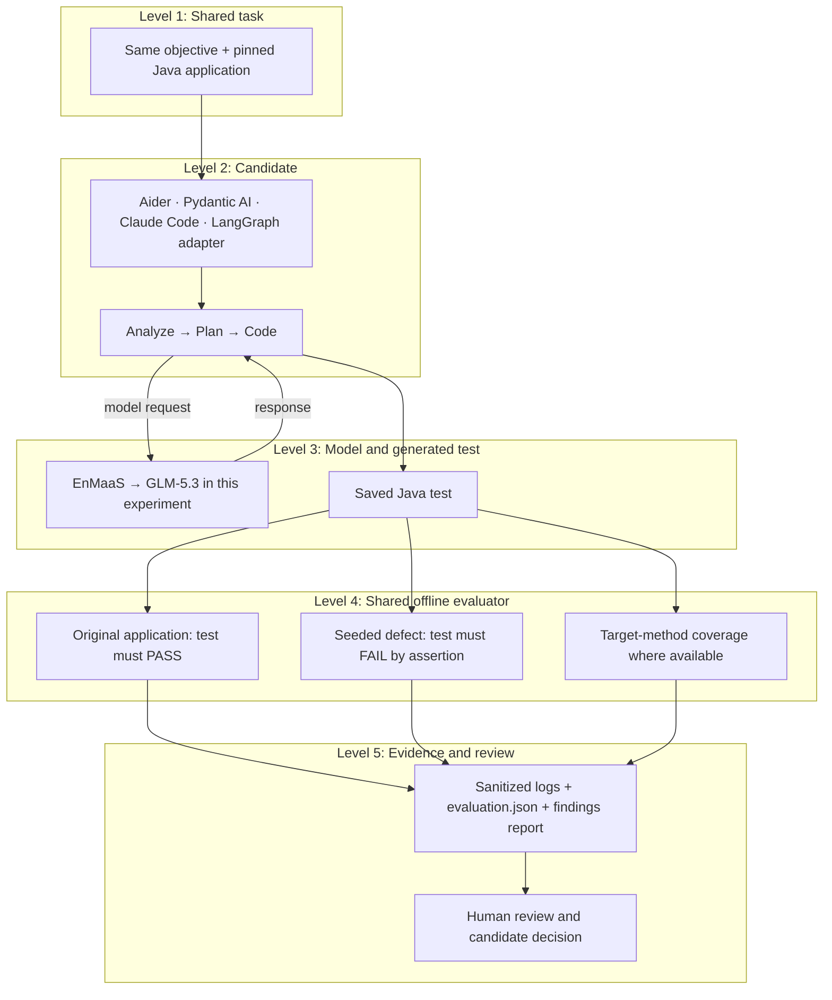

# FLPATH-5050: Evaluation Architecture

**Status:** Evaluation in progress. Four candidates generated tests that detected the Quarkus and Spring XML defects; Aider's Spring result came from a separate diagnostic after an earlier timeout. No implementation tool or provider has been selected.

## Decision this spike supports

[FLPATH-5050](https://redhat.atlassian.net/browse/FLPATH-5050) compares ways to implement the AI Test Generation (ATG) Analyze → Plan → Code → Execute flow. Candidates may serve different layers. The outcome is a recommendation to reuse, fork, use as a reference, or replace a candidate **at a named layer**, supported by evidence. Running a candidate does not make it an ATG dependency.

The evaluator checks the test a candidate produces. It does not invoke a model, select an implementation, or change the ATG service contracts.

## Evaluation flow

The same task, fixture, and model are used for each candidate in this
experiment. Each candidate analyzes the supplied code, plans a test, and
generates a Java test. A shared evaluator then runs that test offline.

- **Level 1:** Each candidate receives the same objective and pinned
  application source. The Quarkus and Spring XML tasks are separate cohorts.
- **Level 2:** Aider and Claude Code are invoked by the runner. Pydantic AI
  and LangGraph use adapters. All four use the shared evaluator for Execute.
- **Level 3:** The current experiment uses one EnMaaS endpoint and model.
  The saved test is the candidate's output; it is reviewed along with the
  analysis and plan.
- **Level 4:** A useful test passes on the original and fails by assertion on
  the seeded defect. Setup errors, timeouts, and missing tests remain blocked
  or inconclusive. Spring target-method coverage compares the existing suite
  with the suite plus the new test; Quarkus coverage is not measured yet.
- **Level 5:** Saved evidence supports a human decision. A result does not
  automatically select a tool for production.

The task objectives already specify the behavior and required assertions.
The runs do not establish independent coverage-gap discovery or test selection.
A seeded defect checks test sensitivity; it does not prove a CVE fix. Coverage
shows which code ran, not whether the test checked the correct result. See the
[Quarkus runbook](../../experiments/harness/RERUN.md),
[Spring runbook](../../experiments/harness/SPRING_RERUN.md), and
[findings guide](../../experiments/harness/FINDINGS.md) to run and review a
comparison.

## Repository file map

- **Architecture and usage:** This document; [experiment README](../../experiments/harness/README.md); [findings and future-candidate guide](../../experiments/harness/FINDINGS.md); [Quarkus rerun guide](../../experiments/harness/RERUN.md); [Spring rerun guide](../../experiments/harness/SPRING_RERUN.md); [four-candidate runner](../../experiments/harness/run_comparison.py).
- **Evaluators:** [candidate evaluator](../../experiments/harness/candidate_evaluation.py); [deterministic fake-model replay](../../experiments/harness/fake_model_replay.py).
- **Candidates:** [Pydantic AI adapter](../../experiments/harness/candidates/pydantic_ai/adapter.py) and [LangGraph adapter](../../experiments/harness/candidates/langgraph/adapter.py); Aider and Claude Code are invoked by the [runner](../../experiments/harness/run_comparison.py). All four use the shared evaluator for Execute.
- **Profiles and tasks:** [fixture profiles](../../experiments/harness/fixture_profiles.py); [Quarkus staged objective](../../experiments/harness/fixtures/quarkus-blank-user-staged-objective.md); [Spring XML deposit objective](../../experiments/harness/fixtures/spring-xml-deposit-objective.md); [Spring XML reference test](../../experiments/harness/fixtures/SpringXmlLowercaseDepositReferenceTest.java); [Spring transfer objective](../../experiments/harness/fixtures/spring-transfer-objective.md).
- **Reports and evidence tools:** [campaign findings](../../experiments/harness/FLPATH-5050-campaign-findings.md); [report builder](../../experiments/harness/build_findings.py); [archive exporter](../../experiments/harness/archive_evidence.py); [coverage reanalysis](../../experiments/harness/reanalyze_coverage.py); [run-spec example](../../experiments/harness/run-spec.example.json). The campaign's complete run archives remain on the experiment host, not in this repository.
- **Shared candidate task and control:** [blank-user objective](../../experiments/harness/fixtures/blank-user-objective.md); [manual reference Java test](../../experiments/harness/fixtures/TransferBlankUserTest.java); [reference invocation record](../../experiments/harness/fixtures/reference-invocation.json).
- **Earlier replay inputs:** [transfer objective](../../experiments/harness/fixtures/transfer-objective.json); [recorded Java test response](../../experiments/harness/fixtures/TransferGeneratedReplayTest.java).
- **Automated checks:** [candidate evaluator tests](../../tests/replay/test_candidate_evaluation.py); [fake-model replay tests](../../tests/replay/test_fake_model_replay.py); [comparison runner tests](../../tests/replay/test_run_comparison.py); [test package marker](../../tests/replay/__init__.py).
- **Earlier recorded results:** [2026-11-18 four-candidate EnMaaS rerun](../../experiments/harness/results/enmaas-devshift-glm53-2026-11-18/README.md), including tests, evaluator records, and failed-attempt evidence.
- **Historical results:** [2026-11-17 gateway check](../../experiments/harness/results/enmaas-devshift-glm53-2026-11-17/README.md); [2026-11-16 package-first experiment](../../experiments/harness/results/enmaas-package-first-2026-11-16/README.md); [earlier reference evaluation](../../experiments/harness/results/reference-blank-user-evaluation.json); [fake-model replay record](../../experiments/harness/results/fake-model-replay.json); [Java/Quarkus execution record](../../experiments/harness/results/quarkus-transfer-execution.json).

## Common technical experiment

1. Choose a pinned profile and give every candidate the same objective and source context. The staged tasks include [Quarkus blank-user](../../experiments/harness/fixtures/quarkus-blank-user-staged-objective.md) and [Spring XML lowercase deposit](../../experiments/harness/fixtures/spring-xml-deposit-objective.md). Keep the reference test and mutation out of the candidate's input.
2. Pin the candidate version, source revision, model, endpoint, configuration, prompt, and execution budget. Use the same approved model and endpoint across candidates where supported. When that is impossible, report the **tool + model + endpoint combination** as the result; do not attribute differences to the tool alone.
3. Save the new native Java test and a redacted invocation record. Do not change application code, existing tests, or build files.
4. Pass the test to the [candidate evaluator](../../experiments/harness/candidate_evaluation.py). It verifies the fixture digest and installs only the submitted test in two disposable copies. For **every** candidate and copy, it first runs offline `mvn -DskipTests package`, then runs only the submitted test class with offline `mvn test`. The second copy has the profile's seeded defect: empty users accepted for Quarkus, or a case-sensitive deposit check for Spring XML.
5. Review the generated test, Maven reports, and evaluator record. Repeat candidate runs with fresh workspaces to observe model variability; keep every attempt, including failures.

The shared task uses a `requestReference` different from the existing fixture test's `req-001`; it does not require a random value on every run. The result is `discriminates` only if packaging succeeds for both copies, the submitted test passes on the unchanged fixture, and it fails by assertion on the changed fixture. The report records package and test commands, logs, and outcomes separately. Package failures, absent or skipped tests, timeouts, and environment failures remain blocked or inconclusive. This single behavior check does not prove a CVE fix or overall test-generation quality.

## Evaluate candidates by the layer they could own

Tomas's shortlist starts with Aider, one or two additional documented third-party tools, and [`fullsend-ai/test-creator`](https://github.com/fullsend-ai/test-creator) if it is practical to run. Include Pydantic AI. Prefer one provider across Analyze, Plan, Code, and Execute unless a specialized provider has a demonstrated advantage.

- **Generation and execution harness:** Aider and Claude Code generated tests for the common task; execution used the separate evaluator. Screen [`ai-test-harness`](https://github.com/croadfeldt/ai-test-harness) and another documented third-party option for ownership, license, maintenance, and testability. Assess output, file scope, retries, recovery, local operation, and evidence before assigning a layer.
- **Planning and test creation:** Try fullsend if setup is light. Evaluate its Plan or Code output at that boundary; do not score it as a full execution harness without execution evidence.
- **Model and orchestration integration:** Pydantic AI and LangGraph adapters generated tests for the common task. Evaluate provider isolation, explicit state, checkpoints, replay, and failure recovery; consider direct SDKs where they help answer a specific integration question.
- **External evaluation:** Consider CyberGym and bounded VVAH as independent inputs, separate from implementation-harness selection.

Do not combine unlike layers into one overall score. State when a candidate can or cannot cover all four lifecycle stages. For **each viable option**, record ownership, licensing, security, maintenance, local testability, provider isolation, and ATG fit. Record `unknown` when evidence is missing. The [repository experiments guide](../../experiments/README.md) also requires source revision, tested capabilities, reproduction command, results, limitations, and a promotion or removal decision.

## Evidence and trust boundaries

Keep an evidence packet per candidate attempt: exact source and tool revisions; model and approved endpoint labels; prompt and sanitized configuration hashes; redacted command; generated-test content hash; fixture revision and verified file digest; container identity; exact Maven commands; exit codes; Surefire counts; logs; limitations; and unresolved decisions. Preserve candidate failures instead of reporting only successful attempts.

Model invocation and test execution are separate boundaries. The evaluator runs generated Java code with network access disabled, a read-only Maven cache, and CPU, memory, process, and file-size limits. The writable workspace has no total disk quota: use a disposable, quota-limited host or volume for real candidate output. The submitted test can write Surefire XML in its workspace, so `discriminates` is a review signal rather than tamper-proof evidence.

## Current evidence and decisions

The [campaign findings](../../experiments/harness/FLPATH-5050-campaign-findings.md) compare Aider, Pydantic AI, Claude Code, and LangGraph across the staged Quarkus and Spring XML tasks. All four detected the Quarkus defect. The Spring campaign's Aider Analyze stage timed out; an Aider-only diagnostic later detected the Spring defect, as did the other three candidates in the original campaign. The diagnostic has a different specification and evaluator identity. It is not a fixed-configuration repeat. Coverage is measured for selected Spring methods; Quarkus coverage is not measured. More coverage alone does not establish that a test finds a defect. No candidate is selected for production.

The [2026-11-18 rerun](../../experiments/harness/results/enmaas-devshift-glm53-2026-11-18/README.md) used one blank-user objective, pinned Java 21/Quarkus fixture, EnMaaS GLM 5.3 model, and offline evaluator. Aider 0.86.2, Pydantic AI 2.68.0, Claude Code 2.1.296, and a LangGraph 1.0.8 adapter each generated a test that passed on the original application and failed by assertion on one seeded defect. The 24 passing replay/evaluator checks were recorded with that November 18 run; the newer runner tests are not part of its live result.

The record preserves an excluded Aider workspace-permission attempt and a LangGraph JSON-mode attempt that exhausted its response allowance without a test. LangGraph produced a test after switching to a structured tool call. Aider and LangGraph generated byte-identical Java tests. These outcomes cover one behavior and do not rank the candidates, prove a CVE fix, or demonstrate the complete Analyze → Plan → Code → Execute lifecycle. The [November 17 gateway check](../../experiments/harness/results/enmaas-devshift-glm53-2026-11-17/README.md) and [November 16 package-first experiment](../../experiments/harness/results/enmaas-package-first-2026-11-16/README.md) remain historical evidence; the latter used a different model. No candidate recommendation has been made.

EnMaaS and models.corp are sufficient test endpoints where available. The spike evaluates provider and harness integration, not model quality. Production is expected to support customer-provided models. The team owns experiment orchestration and evidence; keep experiment work under `experiments/`. Production application and pipeline ownership remain open. Treat dependencies and evidence coordination with other tickets as optional unless a tested integration requires them. Next, make the run reproducible from a clean checkout, screen the remaining shortlist, test more behaviors and failure paths, then record a reuse/fork/reference/replace recommendation by layer.
